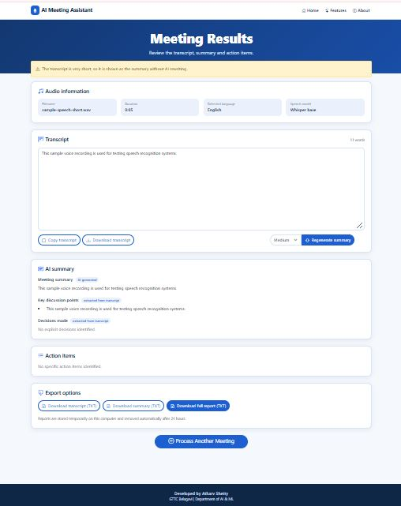

# 🎙️ AI Meeting Assistant
## Speech Recognition and Meeting Summarization Using AI

An AI-powered web application that converts audio recordings into text transcripts and generates concise meeting summaries. The system uses OpenAI Whisper for speech recognition and Hugging Face Transformers for natural language processing and text summarization.

The application provides a simple and user-friendly web interface that allows users to upload audio recordings, generate transcripts and summaries, and download the results for future reference.

---

## 📌 Project Overview

Meetings, lectures, interviews, and discussions often contain important information that takes considerable time to review. This project provides a web-based solution that automatically processes audio recordings and generates:

- A complete text transcript of the spoken conversation
- A concise summary of the conversation
- Downloadable transcript and summary files
- A simple interface for uploading and processing audio recordings

The project demonstrates the practical application of Artificial Intelligence, Speech Recognition, Natural Language Processing, and Deep Learning.

---

## 🎯 Objectives

- Convert speech from audio recordings into text.
- Generate concise summaries from long conversations.
- Reduce the time required to review meeting recordings.
- Provide downloadable transcripts and summaries.
- Develop a user-friendly web application using Flask.
- Demonstrate the practical use of AI, speech recognition, and NLP.
- Understand the integration of pretrained transformer models into a web application.

---

## ✨ Key Features

| Feature | Description |
|---|---|
| 🎵 Audio Upload | Upload audio recordings for processing |
| 🎙️ Speech Recognition | Convert speech into text using Whisper |
| 🧠 Text Summarization | Generate concise summaries using a transformer model |
| 📝 Transcript Display | View the complete recognized conversation |
| 📄 Summary Display | Read the summarized meeting content |
| ⬇️ Download Transcript | Download the transcript as a text file |
| ⬇️ Download Summary | Download the summary as a text file |
| 🔊 Audio Processing | Validate and convert audio using FFmpeg |
| 🌐 Web Interface | Access the application through a browser |
| 🧪 Automated Testing | Test application components using Pytest |

---

## 📸 Project Screenshots

### 1. Home Page

The home page provides the main interface for the application. Users can upload an audio recording and begin the transcription and summarization process.


### 2. Transcript Output

The transcript section displays the text recognized from the uploaded audio. Users can review the generated transcript and download it for future reference.


### 3. Meeting Summary

The summary section presents the main information from the meeting in a concise format. It helps users understand the key discussion points without reviewing the entire transcript.



> **Note:** Save your screenshots using the exact filenames shown above inside the `DOCUMENTS/SCREENSHOT/` folder. If your filenames are different, update the image paths accordingly.

---

## 🧠 System Workflow

The application follows the workflow shown below:

```text
             Audio Recording
                    |
                    v
               Audio Upload
                    |
                    v
          Audio Preprocessing
                (FFmpeg)
                    |
                    v
          Speech Recognition
                (Whisper)
                    |
                    v
          Generated Transcript
                    |
                    v
          Text Summarization
          (Transformer Model)
                    |
                    v
             Meeting Summary
                    |
                    v
          View and Download Results
```

### Workflow Explanation

1. **Audio Upload:** The user uploads an audio recording through the web interface.
2. **Audio Preprocessing:** The audio file is validated and converted into a suitable format using FFmpeg.
3. **Speech Recognition:** Whisper processes the audio and converts spoken words into text.
4. **Transcript Generation:** The recognized speech is displayed as a text transcript.
5. **Text Summarization:** A transformer-based summarization model processes the transcript.
6. **Summary Generation:** The system generates a concise summary containing the main information.
7. **Result Display:** The transcript and summary are displayed on the web interface.
8. **Download:** The user can download the generated transcript and summary.

---

## 🛠️ Technologies Used

| Technology | Purpose |
|---|---|
| Python | Main programming language |
| Flask | Backend web framework |
| OpenAI Whisper | Speech-to-text transcription |
| Hugging Face Transformers | AI-based text summarization |
| FFmpeg | Audio conversion and processing |
| HTML | Web page structure |
| CSS | Web page styling |
| JavaScript | Frontend interactions |
| Pytest | Automated testing |
| Git and GitHub | Version control and project hosting |

---

## 📁 Project Structure

```text
AI-Meeting-Assistant/
│
├── app.py
│
├── backend/
│   ├── routes.py
│   └── services.py
│
├── models/
│   ├── __init__.py
│   ├── speech_model.py
│   └── summarization_model.py
│
├── utils/
│   ├── __init__.py
│   └── audio_processing.py
│
├── templates/
│   └── index.html
│
├── static/
│   ├── css/
│   │   └── style.css
│   │
│   └── js/
│       └── script.js
│
├── exports/
│
├── DOCUMENTS/
│   ├── SCREENSHOT/
│   │   ├── HOME PAGE.JPG
│   │   ├── TRANSCRIPT.JPG
│   │   └── SUMMARY.JPG
│   │
│   └── PROJECT DEMO.mp4
│
├── tests/
│   └── test_app.py
│
├── requirements.txt
├── run.bat
└── README.md
```

> The structure above represents the main project components. Additional files may be present depending on the implementation.

---

## ⚙️ Requirements

Before running the application, ensure that the following software is installed:

- Python 3.12
- FFmpeg
- Git
- A modern web browser
- Internet connection for initial AI model downloads

### Hardware Requirements

| Component | Requirement |
|---|---|
| Processor | Intel or AMD processor |
| RAM | 8 GB recommended |
| Storage | Sufficient space for Python packages and AI models |
| GPU | Optional |
| Internet | Required for initial model downloads |

The application can run using CPU inference, although processing may take longer than GPU inference.

---

## 💻 Installation and Setup

Follow these steps to install and run the project on Windows.

### Step 1: Clone the Repository

Open PowerShell or the terminal and execute:

```bash
git clone https://github.com/Atharv-Ai09/AI-Meeting-Assistant.git
```

### Step 2: Open the Project Folder

```bash
cd AI-Meeting-Assistant
```

### Step 3: Create a Virtual Environment

Make sure Python 3.12 is installed.

```bash
py -3.12 -m venv .venv
```

### Step 4: Activate the Virtual Environment

For Windows PowerShell:

```powershell
Set-ExecutionPolicy -Scope Process -ExecutionPolicy Bypass
.\.venv\Scripts\Activate.ps1
```

For Windows Command Prompt:

```cmd
.venv\Scripts\activate.bat
```

### Step 5: Install Python Dependencies

Upgrade pip:

```bash
python -m pip install --upgrade pip
```

Install the required packages:

```bash
pip install -r requirements.txt
```

### Step 6: Install FFmpeg

Download FFmpeg from the official website:

https://ffmpeg.org/download.html

After installation, add FFmpeg to your system PATH.

Verify the installation:

```bash
ffmpeg -version
```

If FFmpeg is installed correctly, the command displays the installed version and configuration information.

### Step 7: Run the Application

Start the Flask application:

```bash
python app.py
```

Open the following address in your web browser:

http://127.0.0.1:5000

> The first run may download the required AI models. Model loading and audio processing may take some time depending on your computer and internet connection.

---

## 🚀 How to Use the Application

1. Install the required dependencies.
2. Run the Flask application using `python app.py`.
3. Open the application in your browser.
4. Upload a supported audio recording.
5. Start the audio processing operation.
6. The application preprocesses the audio using FFmpeg.
7. Whisper converts the spoken conversation into text.
8. The summarization model generates a concise meeting summary.
9. Review the transcript and summary on the web interface.
10. Download the transcript and summary files if required.

---

## 🧪 Testing

The project includes automated tests for application components and API functionality.

### Run Automated Tests

Execute the following command from the project directory:

```bash
python -m pytest
```

### Manual Testing

The application should also be tested using real audio recordings.

| Test Case | Expected Result |
|---|---|
| Open application | Home page loads successfully |
| Upload valid audio | Audio is accepted |
| Upload invalid file | Appropriate error message is displayed |
| Process audio | Speech recognition begins |
| Generate transcript | Recognized text is displayed |
| Generate summary | Concise summary is displayed |
| Download transcript | Transcript file is downloaded |
| Download summary | Summary file is downloaded |

---

## 📊 Expected Output

After processing an audio recording, the application provides the following results:

### 1. Transcript

The complete recognized spoken content from the uploaded audio recording.

### 2. Meeting Summary

A concise overview of the conversation containing the main discussion points and important information.

### 3. Downloadable Files

The user can download the generated transcript and summary as text files for future reference.

### Example Output

```text
Transcript:
The complete recognized conversation appears here.

Summary:
The meeting discussed the main project objectives,
important updates, and upcoming tasks.
```

> The above is an illustrative example. Actual output depends on the uploaded audio recording.

---

## 🔐 Limitations

- Transcription accuracy may decrease when audio contains background noise.
- Speech recognition performance may vary depending on accents and pronunciation.
- Processing time depends on recording length and hardware performance.
- Initial model downloads require an internet connection.
- CPU-based inference may be slower than GPU-based inference.
- Generated summaries may omit minor details from the original conversation.
- The quality of the output depends on the selected AI models and the clarity of the recording.

---

## 🔮 Future Enhancements

The project can be improved by adding the following features:

- Speaker identification and diarization
- Support for multiple languages
- Automatic action-item extraction
- Meeting highlights and key-point detection
- Searchable meeting history
- Cloud storage and sharing
- GPU acceleration for faster processing
- Export summaries to PDF and DOCX
- Real-time meeting transcription
- Improved summarization accuracy
- User authentication and personalized meeting history

---

## 🎥 Video Demonstration

Watch the project demonstration to understand the complete workflow, from uploading an audio recording to generating the transcript and meeting summary.

### AI Meeting Assistant Demo

[](DOCUMENTS/PROJECT%20DEMO.mp4)

▶️ **[Click here to watch the complete project demonstration](DOCUMENTS/PROJECT%20DEMO.mp4)**

The video demonstrates:

- Application home page
- Audio recording upload
- Speech recognition process
- Generated transcript
- Meeting summary
- Downloading the results

> **Note:** GitHub does not reliably play MP4 videos embedded as ordinary Markdown links. The link above opens the video file. For a more accessible demonstration, you can also upload the video to YouTube and add its link here.

---

## 👨‍💻 Developer

**Atharv Shetty**

Diploma in Artificial Intelligence and Machine Learning  
GTTC Belagavi, Karnataka, India

GitHub: [Atharv-Ai09](https://github.com/Atharv-Ai09)

Project: [AI Meeting Assistant](https://github.com/Atharv-Ai09/AI-Meeting-Assistant)

---

## 📄 License

This project is developed for educational and academic purposes.

---

⭐ **If you find this project useful, consider giving the repository a star on GitHub!**
